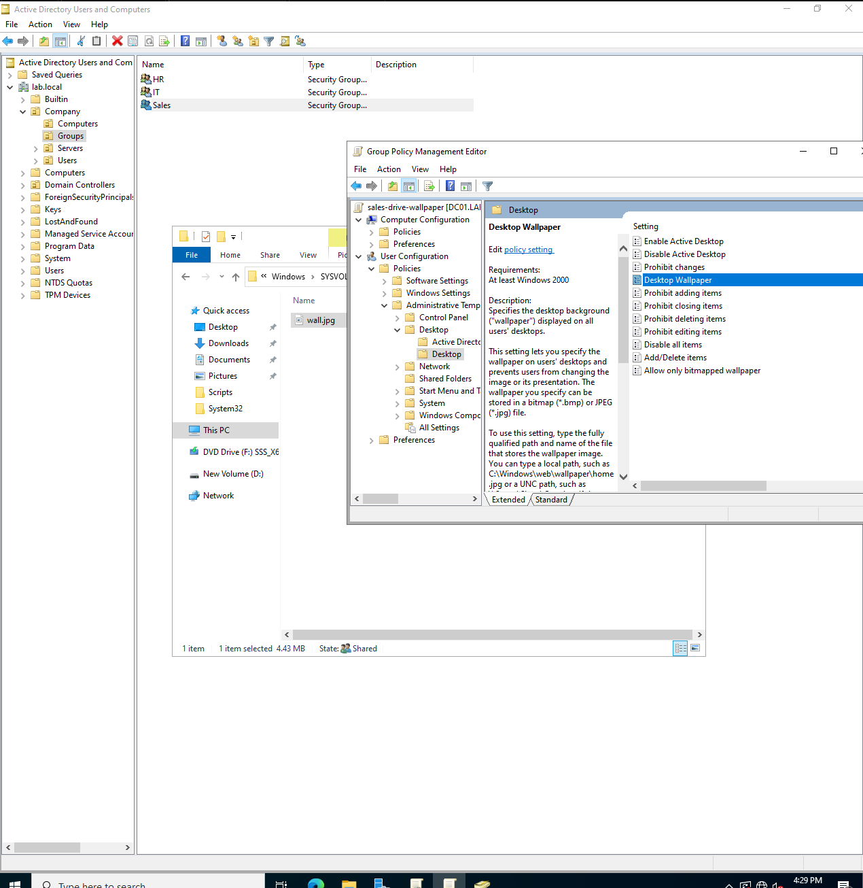
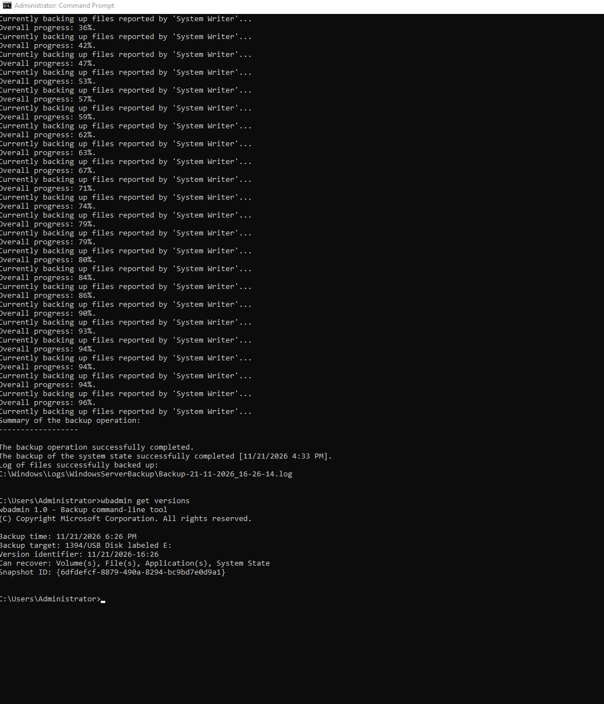
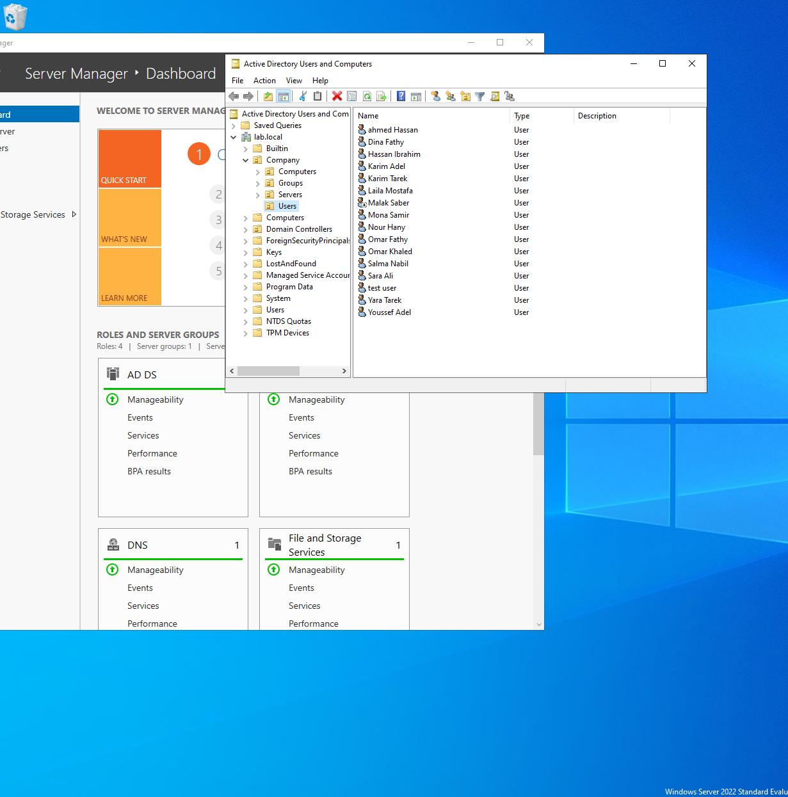
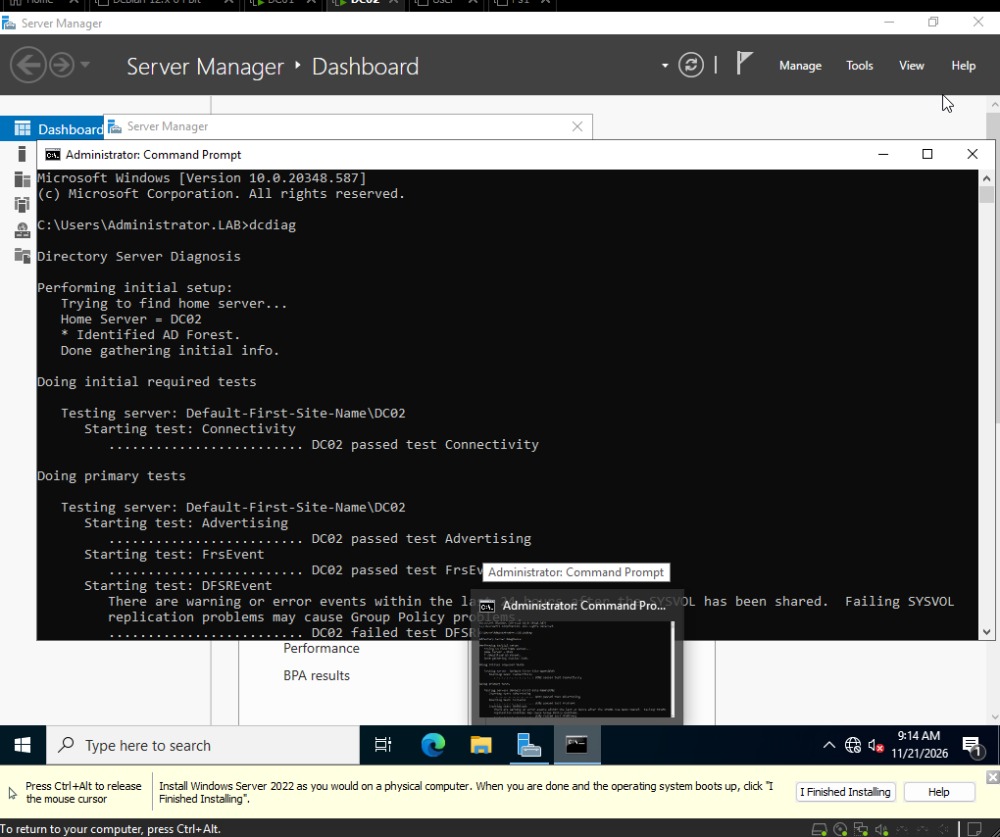

# 01 · Active Directory Lab

Windows Server 2022 domain `lab.local` built from scratch in VMware Workstation.

> Home lab, not production.

| Week | Topic | Key outcomes |
|---|---|---|
| [Week 1](week1-README.md) | Domain build | DC01 promoted to new forest, DNS verified with `dcdiag` / `nslookup`, OU structure created |
| [Week 2](week2-README.md) | Users, client, DHCP, shares, PowerShell | 15 users + IT/Sales/HR groups, CLIENT01 domain-joined, DHCP scope, share + NTFS permissions tested per group, [CSV bulk-user script](../scripts/) |
| [Week 3](#week-3-gpos-file-server-backup-second-dc) | GPOs, file server, backup, second DC | Sales drive/wallpaper GPO, FSRM quota on HR share, system-state backup, Recycle Bin restore, DC02 added |

📋 Day-by-day notes: [progress-log.md](progress-log.md)

## Environment

| Item | Value |
|---|---|
| Hypervisor | VMware Workstation |
| DC01 | Windows Server 2022 · 192.168.10.10 · AD DS, DNS, DHCP, file shares |
| DC02 | 192.168.10.11 · second DC (Week 3) |
| FS1 | 192.168.10.12 · file server, FSRM (Week 3) |
| CLIENT01 | Windows 11 Enterprise eval · DHCP (192.168.10.100) |
| Network | LAN segment `labnet` 192.168.10.0/24 + NAT adapter on DC01 |
| Domain | `lab.local` (new forest) |

## Week 3: GPOs, File Server, Backup, Second DC

> Home lab (VMware), not production.

### Overview
Added Group Policy for the Sales team, a member file server (FS1) with an FSRM quota,
a system-state backup of the DC, an AD Recycle Bin restore test, and a second domain
controller (DC02).

### IP table
| Host | Role | IP |
|---|---|---|
| DC01 | DC, DNS, DHCP | 192.168.10.10 (static) |
| DC02 | Second DC | 192.168.10.11 |
| FS1 | File server, FSRM | 192.168.10.12 |
| CLIENT01 | Windows 11 client | DHCP |

Network: `labnet` 192.168.10.0/24, domain `lab.local`.

### GPOs
| GPO | What it does | Screenshot |
|---|---|---|
| Password / lockout policy | Domain password and account lockout settings | not captured |
| `sales-drive-wallpaper` | Maps the Sales share and sets the desktop wallpaper (`wall.jpg` in SYSVOL) | 3-01, 3-02 |
| Deny removable storage | Blocks removable storage on clients | not captured |

### Shares and quota
| Share | Server | Access | Quota |
|---|---|---|---|
| Sales | DC01 (`\\DC01\Sales`) | Sales group (from Week 2) | none |
| HR | FS1 (`\\fs1\hr`) | HR group (permissions not captured) | FSRM 500 MB |

Quota test: copying a 125 MB folder into the HR share failed with "not enough space".

### Backup and Recycle Bin
- `wbadmin` system-state backup to a separate disk (E:) completed; `wbadmin get versions`
  lists the backup with System State as recoverable.
- AD Recycle Bin: deleted two users, both showed in ADAC > Deleted Objects, restored
  both and confirmed they were back in Company > Users.

### DC02
DC02 joined as a second DC in `lab.local`. `dcdiag` on DC02 passed Connectivity,
Advertising and FrsEvent but **failed DFSREvent** (SYSVOL replication warnings). Still to fix.

### Screenshots
1. GPO `sales-drive-wallpaper`, Desktop Wallpaper setting, `wall.jpg` in SYSVOL
   
2. CLIENT01 with the Sales share mapped (shows twice, as S: and Z:)
   
3. FSRM quota blocks a 125 MB copy to the HR share on FS1
   
4. System-state backup completed, `wbadmin get versions`
   
5. Deleted users in ADAC > Deleted Objects
   
6. Restored user back in Company > Users
   
7. `dcdiag` on DC02 (DFSREvent failed)
   

### Not captured
- Password / lockout GPO settings
- Deny-removable-storage GPO
- FSRM quota setup (500 MB template) and HR share/NTFS permissions on FS1
- FS1 and DC02 IP configuration
- DC02 promotion wizard and `repadmin /replsummary`
- Enabling the AD Recycle Bin
