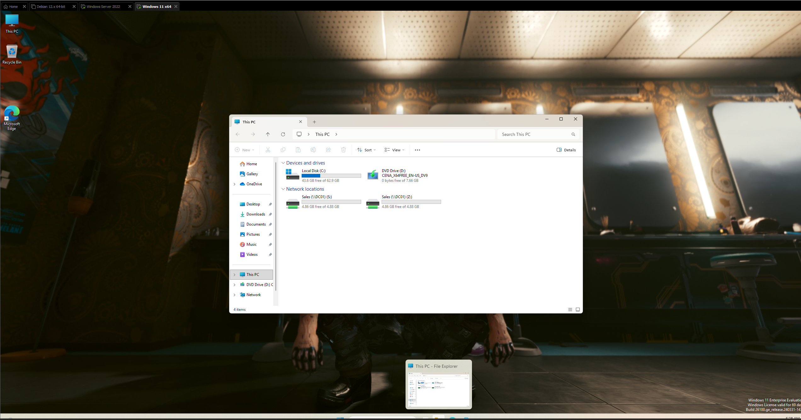
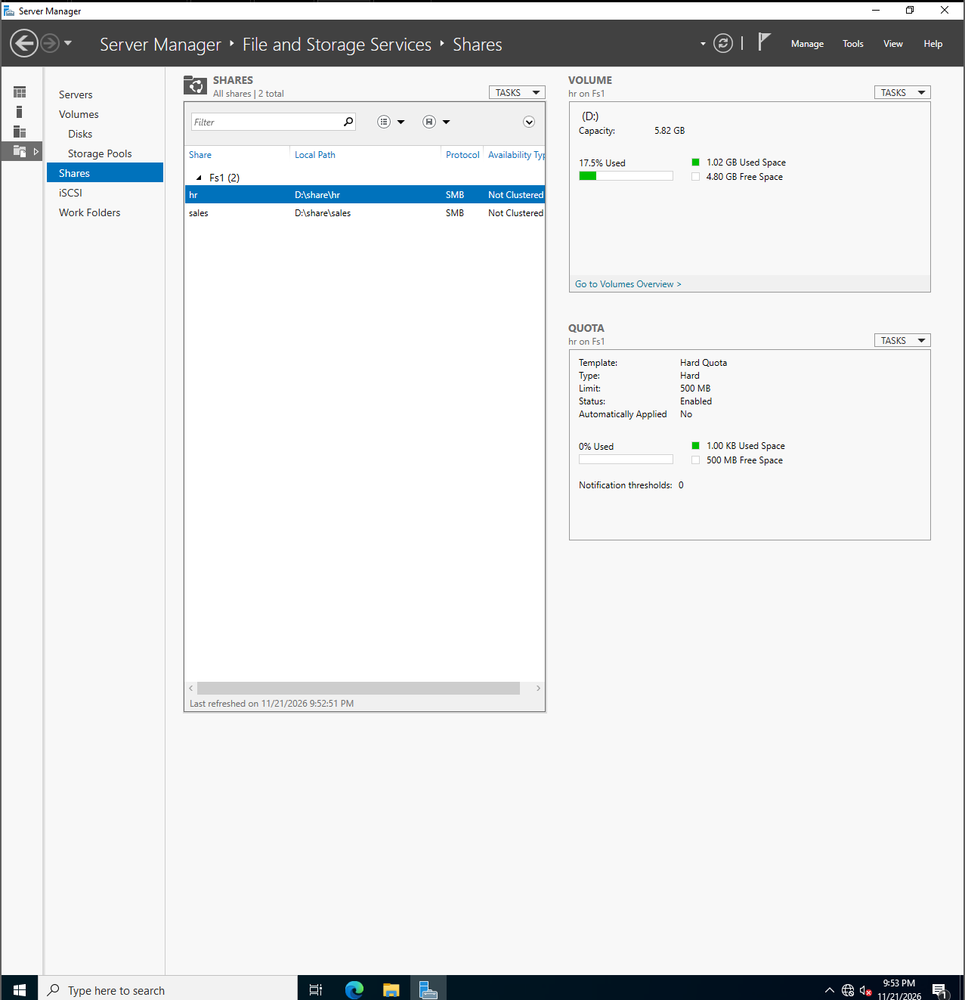
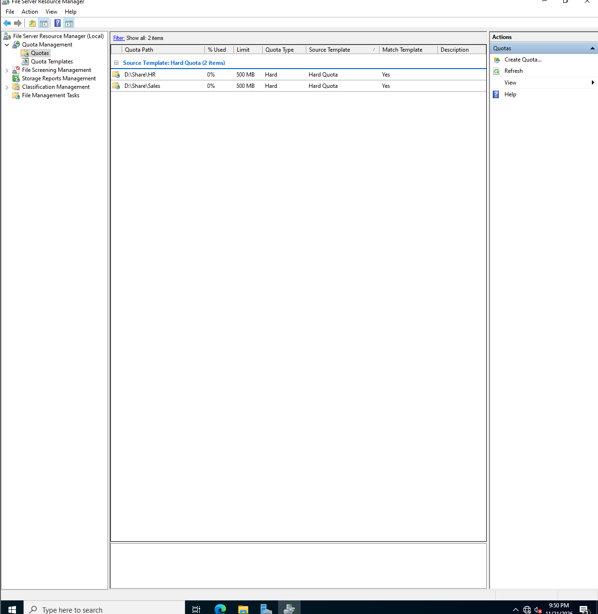
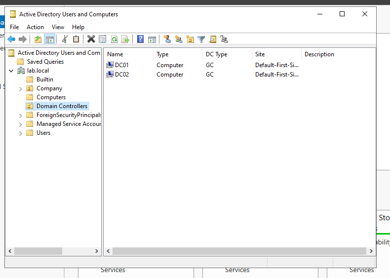
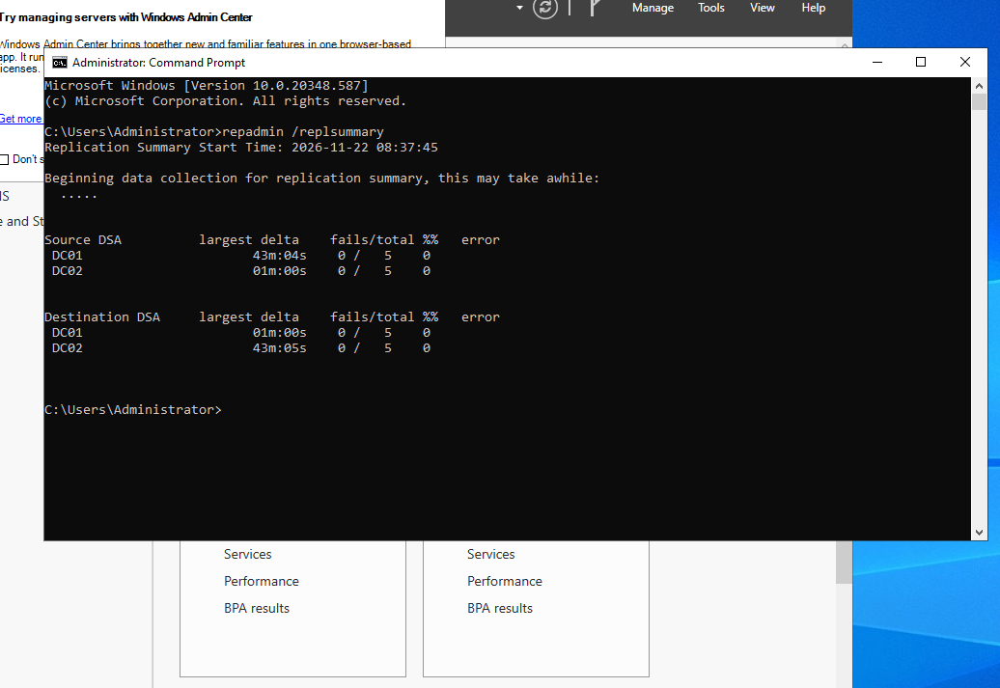
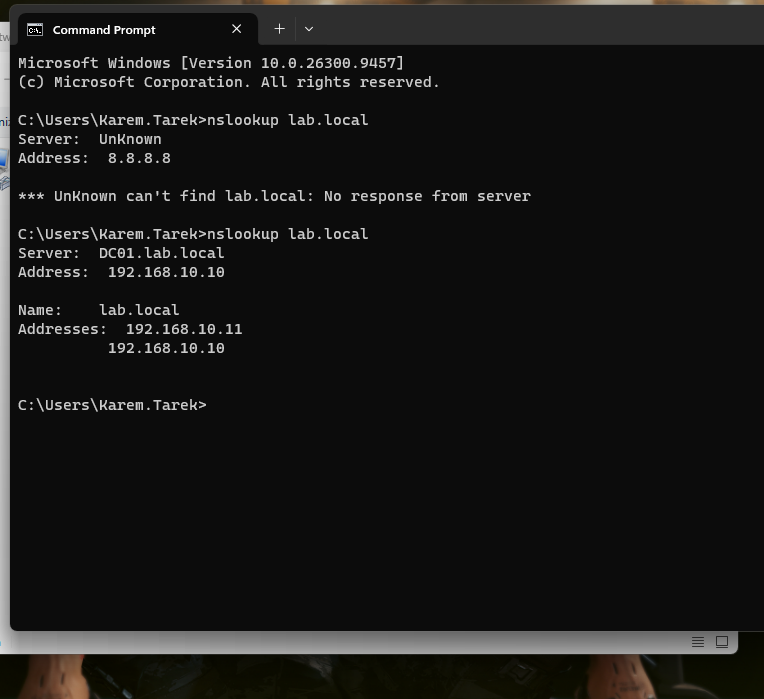
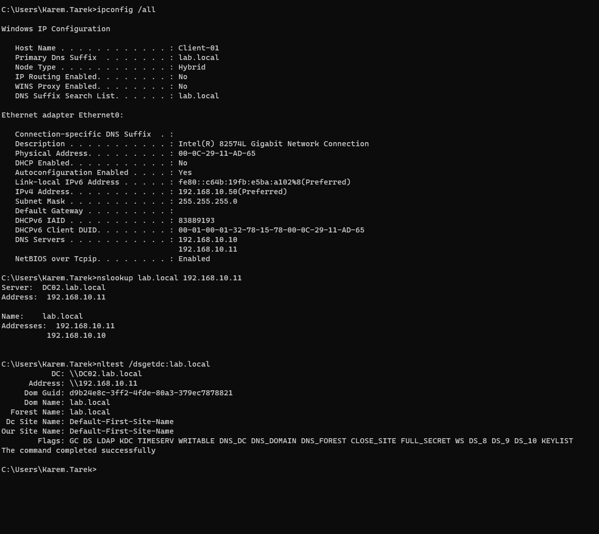
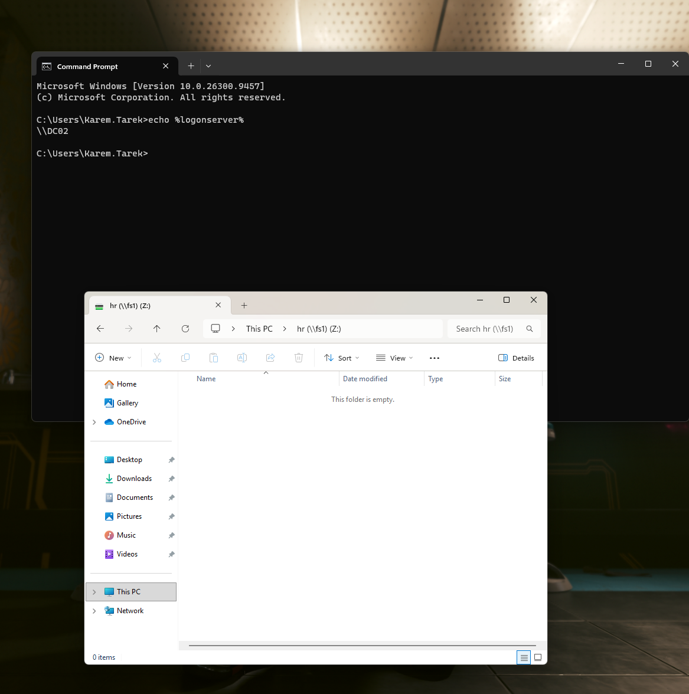
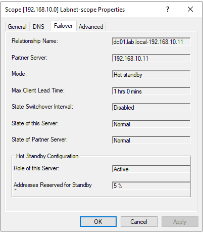
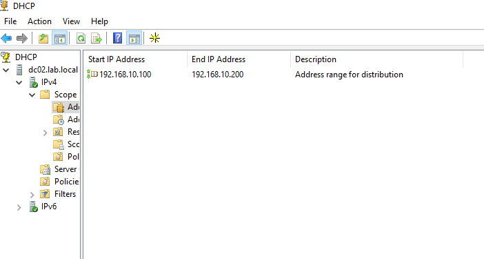

# 01 · Active Directory Lab

Windows Server 2022 domain `lab.local` built from scratch in VMware Workstation.

> Home lab, not production.

| Week | Topic | Key outcomes |
|---|---|---|
| [Week 1](week1-README.md) | Domain build | DC01 promoted to new forest, DNS verified with `dcdiag` / `nslookup`, OU structure created |
| [Week 2](week2-README.md) | Users, client, DHCP, shares, PowerShell | 15 users + IT/Sales/HR groups, CLIENT01 domain-joined, DHCP scope, share + NTFS permissions tested per group, [CSV bulk-user script](../scripts/) |
| [Week 3](#week-3-gpos-file-server-dc02-failover) | GPOs, file server, DC02, failover | Password/lockout, Sales drive/wallpaper and removable-storage GPOs, FS1 with FSRM 500 MB quotas, backup, Recycle Bin restore, DC02 replicating with 0 failures, client works with DC01 down, DHCP hot-standby failover |

📋 Day-by-day notes: [progress-log.md](progress-log.md)

## Environment

| Item | Value |
|---|---|
| Hypervisor | VMware Workstation |
| DC01 | Windows Server 2022 · 192.168.10.10 · AD DS, DNS, DHCP (active), file shares |
| DC02 | Windows Server 2022 · 192.168.10.11 · AD DS, DNS, GC, DHCP (standby) |
| FS1 | Windows Server 2022 · 192.168.10.12 · file server, FSRM |
| CLIENT01 | Windows 11 Enterprise eval · DHCP (scope 192.168.10.100-200) |
| Network | LAN segment `labnet` 192.168.10.0/24 + NAT adapter on DC01 |
| Domain | `lab.local` (new forest) |

## Week 3: GPOs, File Server, DC02, Failover

> Home lab (VMware), not production.

### Overview
Added password/lockout policy and GPOs, a file server (FS1) with FSRM quotas, a system-state
backup, a Recycle Bin restore, and a second DC (DC02). Then tested what happens when DC01 is
down: AD logon, DNS and DHCP all kept working through DC02.

### Topology
```
                labnet 192.168.10.0/24 (no gateway)
   ┌──────────────┬──────────────┬──────────────┬──────────────┐
 DC01 .10       DC02 .11       FS1 .12        CLIENT01
 AD, DNS,       AD, DNS, GC,   file server,   DHCP lease from
 DHCP active    DHCP standby   FSRM           .100-200, DNS .10 + .11
```

### IP table
| Host | Role | IPv4 | DNS servers |
|---|---|---|---|
| DC01 | DC, DNS, DHCP active | 192.168.10.10 static | 192.168.10.10 |
| DC02 | DC, DNS, GC, DHCP standby | 192.168.10.11 static | ::1, .11, .10 |
| FS1 | File server, FSRM | 192.168.10.12 static | 192.168.10.10 |
| CLIENT01 | Windows 11 client | 192.168.10.50 static during the DC01-down test, then DHCP 192.168.10.100 | .10, .11 |

DHCP scope: 192.168.10.100-200, no gateway.

### Users, groups, OUs
```
lab.local
└── Company
    ├── Users      15 users + "test user"
    ├── Computers
    ├── Groups     HR, IT, Sales (global security)
    └── Servers
```

### GPOs
| GPO | Settings |
|---|---|
| Default Domain Policy, password | History 24, max age 42 days, min age 1 day, **min length 3**, complexity disabled |
| Default Domain Policy, lockout | 5 invalid attempts, 30 min lockout, counter resets after 30 min |
| `sales-drive-wallpaper` | Maps the Sales share, sets wallpaper to `wall.jpg` in SYSVOL |
| Deny removable storage | "All Removable Storage classes: Deny all access" = Enabled |

Min length 3 with complexity off is weak; it should be raised to 12+.

### Shares and permissions
Share and NTFS permissions both apply; the most restrictive one wins.

| Share | Server / path | Share permission | NTFS | Quota |
|---|---|---|---|---|
| Sales | DC01, `\\DC01\Sales` (Week 2) | Sales: Full Control | Sales: Modify | none |
| hr | FS1, `D:\share\hr` | HR: Change | Administrators, SYSTEM: Full; HR: Modify; inheritance off | 500 MB hard |
| sales | FS1, `D:\share\sales` | not captured | not captured | 500 MB hard |

### FS1: file server and FSRM
- File Server + FSRM on FS1. Custom template "Hard Quota" = 500 MB, hard.
- Applied to `D:\Share\HR` and `D:\Share\Sales`.
- Test: copying 125 MB into the hr share was blocked with "not enough space".

### Backup and Recycle Bin
- `wbadmin` system-state backup to disk E: completed; `wbadmin get versions` lists System State.
- Recycle Bin is on. Deleted two users, restored both from Deleted Objects.

### DC02 and replication
- DC02 is a second DC and GC (both listed in Domain Controllers).
- `repadmin /replsummary`: 0 / 5 failures both ways, on 21 Nov and again on 22 Nov.
- An earlier `dcdiag` on DC02 failed DFSREvent; not re-run since.

### DC01 failover test
With DC01 down:
- CLIENT01 logged on through DC02: `echo %logonserver%` = `\\DC02`,
  `nltest /dsgetdc:lab.local` returned `\\DC02.lab.local`, and the hr share on FS1 still opened.
- `nslookup lab.local 192.168.10.11` answered from DC02.
- DHCP failover: relationship `dc01.lab.local-192.168.10.11`, hot standby, DC01 active,
  5% of addresses reserved for standby, max client lead time 1 h. DC02 has the same scope.
- After `ipconfig /release` + `/renew`, CLIENT01 got 192.168.10.100 from DHCP server
  192.168.10.11 (DC02), with DNS servers .10 and .11 (scope option 006).

### Troubleshooting
| # | Symptom | Cause | Fix | Evidence |
|---|---|---|---|---|
| 1 | `nslookup lab.local` failed, server 8.8.8.8 | Client DNS pointed to a public DNS | Set client DNS to DC01; `nslookup` answered from DC01 | 3-22 |
| 2 | `dcdiag` DFSREvent / SystemLog failed (Week 1) | Clock 2.7 days off, wrong time zone | Fixed the time zone | [Week 1](week1-README.md) |
| 6 | Sales share would not open for a Sales user (Week 2) | Wrong NTFS permissions | Sales group: Modify on NTFS | [Week 2](week2-README.md) |
| 7 | Clients need DHCP when DC01 is down | DHCP ran only on DC01 | DHCP hot-standby failover to DC02 | 3-25 to 3-27 |
| 8 | Client had only DC01 as DNS | Scope option 006 had one server | Added 192.168.10.11 as second DNS | 3-23, 3-27 |

### Lessons learned
- Single points of failure: DHCP and DNS lived only on DC01. A second DC alone is not enough;
  DHCP failover and a second DNS server in option 006 are what kept the client working.
- GPO paths matter: the wallpaper is in SYSVOL, so it replicates to DC02, but the Sales drive
  map points to `\\DC01\Sales` and depends on DC01 being up.
- `nltest /dsgetdc` and `%logonserver%` quickly show which DC a client is really using.

### Screenshots
**GPOs**
1. Default Domain Policy, password policy
   
2. Default Domain Policy, account lockout policy
   
3. "All Removable Storage classes: Deny all access" enabled
   
4. GPO `sales-drive-wallpaper`, Desktop Wallpaper setting, `wall.jpg` in SYSVOL
   
5. CLIENT01 with the Sales share mapped (shows twice, as S: and Z:)
   

**File server FS1**

6. FS1 `ipconfig /all`: static 192.168.10.12, DNS 192.168.10.10
   
7. FS1 shares (hr, sales) and the hr quota in Server Manager
   
8. hr share permissions: HR = Change
   
9. hr NTFS permissions: HR = Modify, inheritance off
   
10. FSRM quota templates with the custom 500 MB "Hard Quota"
    
11. FSRM quotas on `D:\Share\HR` and `D:\Share\Sales`
    
12. Quota blocks a 125 MB copy to the hr share
    

**Backup and Recycle Bin**

13. System-state backup completed, `wbadmin get versions`
    
14. "Enable Recycle Bin" greyed out, so it is already on
    
15. Deleted users in ADAC > Deleted Objects
    
16. Restored users back in Company > Users
    

**DC02**

17. DC02 `ipconfig /all`: static 192.168.10.11
    
18. DC01 and DC02 in Domain Controllers, both GC
    
19. `dcdiag` on DC02 (DFSREvent failed)
    
20. `repadmin /replsummary` on 21 Nov: 0 failures
    

**Failover and troubleshooting**

21. `repadmin /replsummary` on 22 Nov: 0 failures
    
22. Client DNS set to 8.8.8.8 fails, then works against DC01
    
23. DC01 down: `nltest /dsgetdc:lab.local` returns DC02, `nslookup` via DC02
    
24. DC01 down: `%logonserver%` = `\\DC02`, hr share still opens
    
25. DHCP failover: hot standby, DC01 active, partner 192.168.10.11
    
26. Scope 192.168.10.100-200 on DC02
    
27. CLIENT01 lease 192.168.10.100 from DHCP server 192.168.10.11
    

### Not captured
- Topology diagram image (text diagram above only)
- Password policy at min length 12 (screenshot shows 3)
- Troubleshooting 2 at 10-minute Kerberos clock skew, 3 broken computer trust / rejoin,
  4 GPO link disabled, 5 locked-out user
- CLIENT01 getting 169.254.x.x while DC01 was down
- Sales share and NTFS permissions on FS1, DC02 promotion wizard, `dcdiag` re-run on DC02
