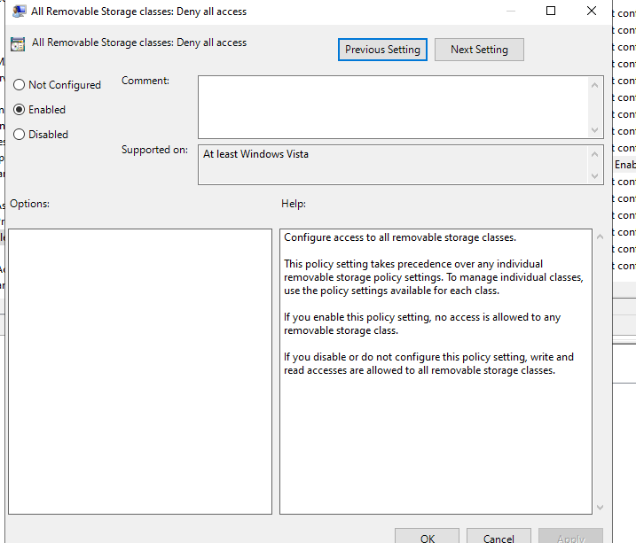
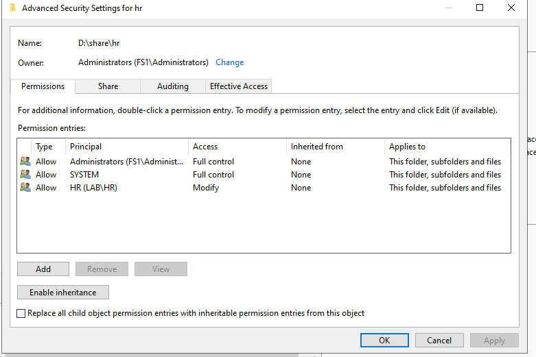
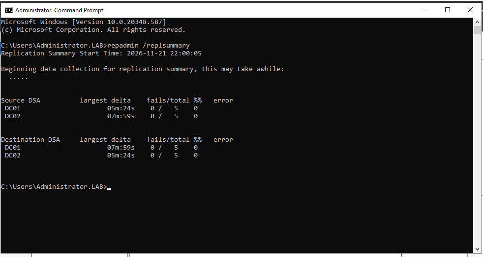

# 01 · Active Directory Lab

Windows Server 2022 domain `lab.local` built from scratch in VMware Workstation.

> Home lab, not production.

| Week | Topic | Key outcomes |
|---|---|---|
| [Week 1](week1-README.md) | Domain build | DC01 promoted to new forest, DNS verified with `dcdiag` / `nslookup`, OU structure created |
| [Week 2](week2-README.md) | Users, client, DHCP, shares, PowerShell | 15 users + IT/Sales/HR groups, CLIENT01 domain-joined, DHCP scope, share + NTFS permissions tested per group, [CSV bulk-user script](../scripts/) |
| [Week 3](#week-3-gpos-file-server-backup-second-dc) | GPOs, file server, backup, second DC | Password/lockout, Sales drive/wallpaper and removable-storage GPOs, FS1 file server with FSRM 500 MB quotas, system-state backup, Recycle Bin restore, DC02 replicating with 0 failures |

📋 Day-by-day notes: [progress-log.md](progress-log.md)

## Environment

| Item | Value |
|---|---|
| Hypervisor | VMware Workstation |
| DC01 | Windows Server 2022 · 192.168.10.10 · AD DS, DNS, DHCP, file shares |
| DC02 | Windows Server 2022 · 192.168.10.11 · AD DS, DNS, GC |
| FS1 | Windows Server 2022 · 192.168.10.12 · file server, FSRM |
| CLIENT01 | Windows 11 Enterprise eval · DHCP (192.168.10.100) |
| Network | LAN segment `labnet` 192.168.10.0/24 + NAT adapter on DC01 |
| Domain | `lab.local` (new forest) |

## Week 3: GPOs, File Server, Backup, Second DC

> Home lab (VMware), not production.

### Overview
Added domain password/lockout policy and two GPOs, a member file server (FS1) with FSRM
quotas, a system-state backup, an AD Recycle Bin restore test, and a second domain
controller (DC02).

### IP table
| Host | Role | IPv4 | DNS servers |
|---|---|---|---|
| DC01 | DC, DNS, DHCP | 192.168.10.10 static | 192.168.10.10 |
| DC02 | DC, DNS, GC | 192.168.10.11 static | ::1, .11, .10 |
| FS1 | File server, FSRM | 192.168.10.12 static | 192.168.10.10 |
| CLIENT01 | Windows 11 client | DHCP | from scope |

All on `labnet` 192.168.10.0/24, no default gateway.

### GPOs
| GPO | Settings |
|---|---|
| Default Domain Policy, password | History 24, max age 42 days, min age 1 day, min length 3, complexity disabled, reversible encryption disabled |
| Default Domain Policy, lockout | 5 invalid attempts, 30 min lockout, counter resets after 30 min |
| `sales-drive-wallpaper` | Maps the Sales share, sets desktop wallpaper to `wall.jpg` in SYSVOL |
| Deny removable storage | "All Removable Storage classes: Deny all access" = Enabled |

Note: min length 3 with complexity off is weak and only fine for a lab.

### Shares and quotas (FS1)
| Share | Path | Share permission | NTFS | FSRM quota |
|---|---|---|---|---|
| hr | `D:\share\hr` (`\\Fs1.lab.local\hr`) | HR: Change | Administrators, SYSTEM: Full control; HR: Modify; inheritance off | 500 MB hard |
| sales | `D:\share\sales` | not captured | not captured | 500 MB hard |

Both quotas use a custom "Hard Quota" template (500 MB, hard).
Test: copying a 125 MB folder into the HR share was blocked with "not enough space".

### Backup and Recycle Bin
- `wbadmin` system-state backup to a separate disk (E:) completed; `wbadmin get versions`
  lists System State as recoverable.
- Recycle Bin is on ("Enable Recycle Bin" is greyed out in ADAC). Deleted two users,
  found them in Deleted Objects, restored both and confirmed they were back in Company > Users.

### DC02
DC02 is a second DC and GC in `lab.local` (both DCs listed in Domain Controllers).
- `repadmin /replsummary`: 0 / 5 failures both ways between DC01 and DC02.
- Earlier `dcdiag` on DC02 failed **DFSREvent** (SYSVOL replication warnings). Not re-run yet
  after replication settled.

### Screenshots
**GPOs**
1. Default Domain Policy, password policy
   
2. Default Domain Policy, account lockout policy
   
3. "All Removable Storage classes: Deny all access" enabled
   
4. GPO `sales-drive-wallpaper`, Desktop Wallpaper setting, `wall.jpg` in SYSVOL
   
5. CLIENT01 with the Sales share mapped (shows twice, as S: and Z:)
   

**File server FS1**

6. FS1 `ipconfig /all`: static 192.168.10.12, DNS 192.168.10.10
   
7. FS1 shares (hr, sales) and the hr quota in Server Manager
   
8. hr share permissions: HR = Change
   
9. hr NTFS permissions: HR = Modify, inheritance off
   
10. FSRM quota templates with the custom 500 MB "Hard Quota"
    
11. FSRM quotas on `D:\Share\HR` and `D:\Share\Sales`
    
12. Quota blocks a 125 MB copy to the HR share
    

**Backup and Recycle Bin**

13. System-state backup completed, `wbadmin get versions`
    
14. "Enable Recycle Bin" greyed out, so it is already on
    
15. Deleted users in ADAC > Deleted Objects
    
16. Restored users back in Company > Users
    

**DC02**

17. DC02 `ipconfig /all`: static 192.168.10.11
    
18. DC01 and DC02 in Domain Controllers, both GC
    
19. `dcdiag` on DC02 (DFSREvent failed)
    
20. `repadmin /replsummary`: 0 failures
    

### Not captured
- Sales share and NTFS permissions on FS1
- DC02 promotion wizard (only the result is shown)
- `dcdiag` re-run on DC02 after the DFSREvent failure
