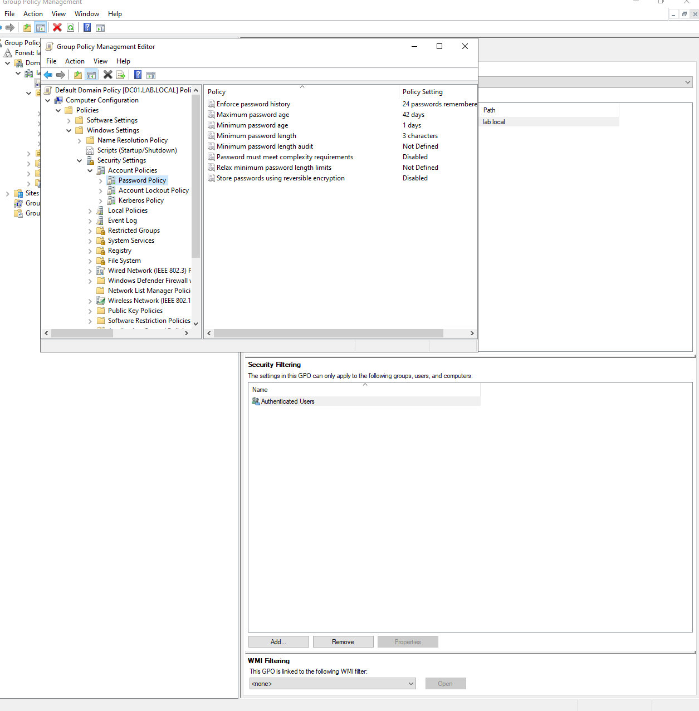
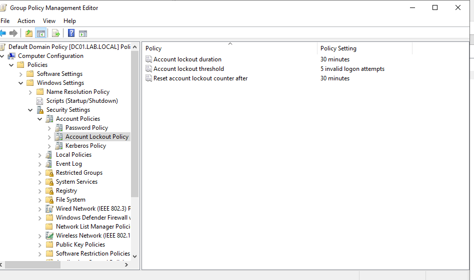
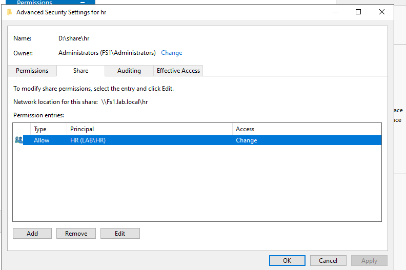
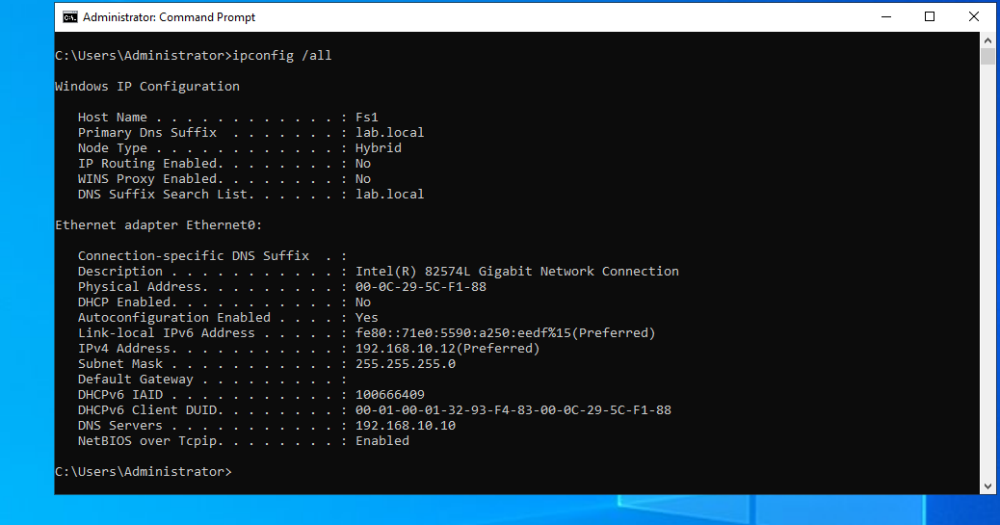
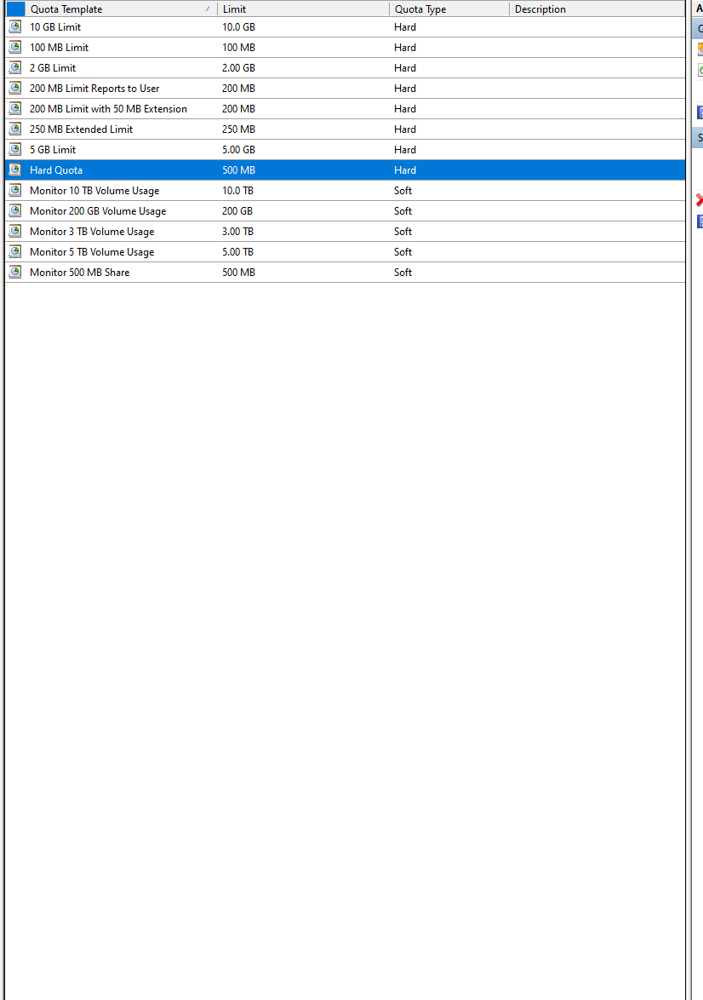
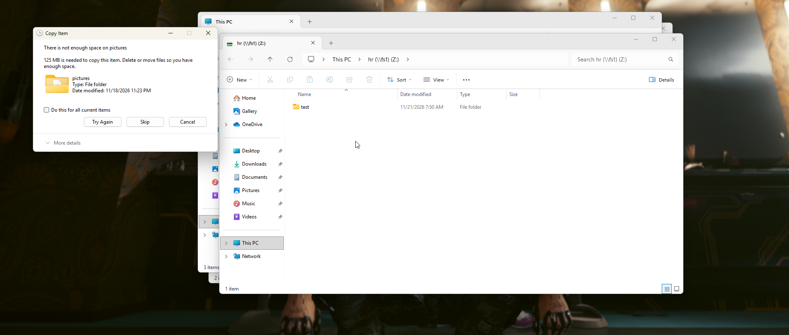
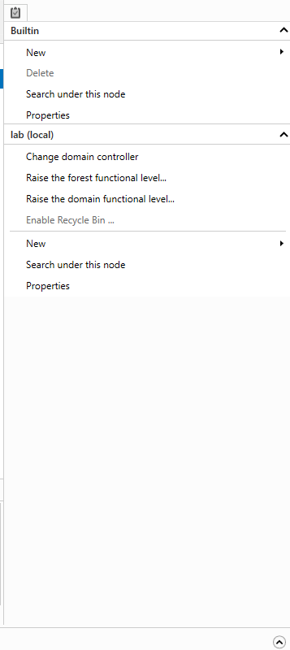
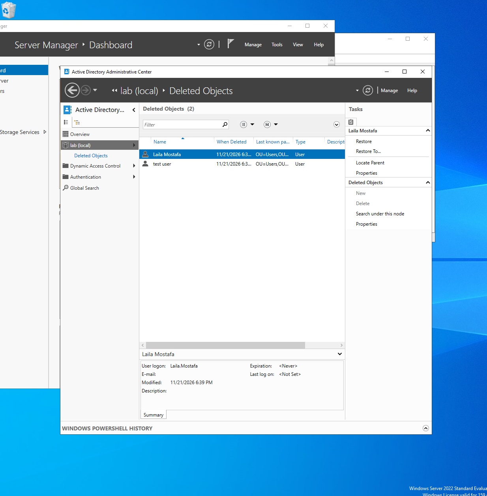
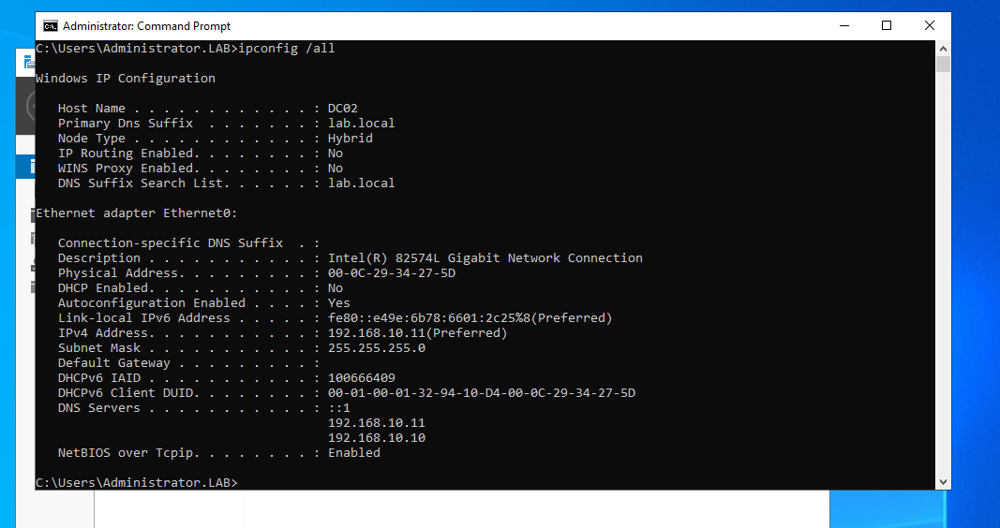
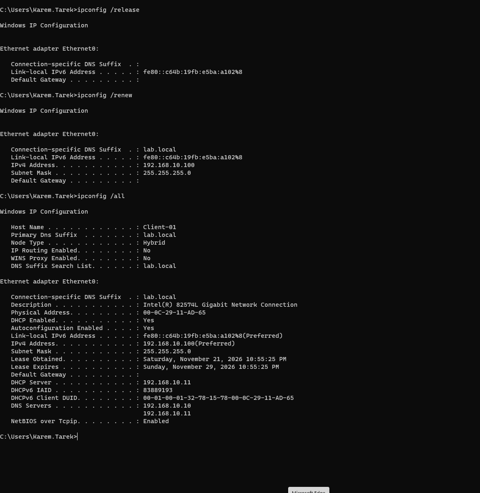

# 01 · Active Directory Lab

A Windows Server 2022 domain (`lab.local`) built from scratch in VMware Workstation:
from one domain controller to two DCs, a file server and a client that keeps working
when DC01 is down.

> Home lab, not production. No real credentials are stored here.

## Status
| Week | Topic | Key outcomes | Status |
|---|---|---|---|
| [Week 1](week1-README.md) | Domain build | DC01 promoted to a new forest, DNS verified with `dcdiag` / `nslookup`, OU structure | ✅ Done |
| [Week 2](week2-README.md) | Users, client, DHCP, shares, PowerShell | 15 users + IT/Sales/HR groups, CLIENT01 joined, DHCP scope, share + NTFS permissions per group, [CSV bulk-user script](../scripts/New-UsersFromCsv.ps1) | ✅ Done |
| [Week 3](#week-3-gpos-file-server-dc02-failover) | GPOs, file server, DC02, failover | GPOs, FS1 with FSRM quotas, backup, Recycle Bin restore, DC02 replicating with 0 failures, DHCP hot-standby failover | ✅ Done |

📋 Day-by-day notes: [progress-log.md](progress-log.md)

## Topology
```
                 labnet 192.168.10.0/24 (no gateway)
   ┌───────────────┬───────────────┬───────────────┬───────────────┐
 DC01 .10        DC02 .11        FS1 .12         CLIENT01 .50
 AD DS, DNS      AD DS, DNS, GC  File server     Windows 11
 DHCP active  ◄─ hot standby ─►  FSRM            DNS .10 + .11
                 DHCP standby
```

| Host | OS | IP | Roles |
|---|---|---|---|
| DC01 | Windows Server 2022 | 192.168.10.10 static | AD DS, DNS, DHCP (active), Sales share |
| DC02 | Windows Server 2022 | 192.168.10.11 static | AD DS, DNS, GC, DHCP (standby) |
| FS1 | Windows Server 2022 | 192.168.10.12 static | File server, FSRM |
| CLIENT01 | Windows 11 Enterprise eval | 192.168.10.50 static during the DC01-down test; DHCP 192.168.10.100 after | Domain client |

- Segment `labnet` 192.168.10.0/24. DC01 also has a NAT adapter for internet.
- DHCP scope 192.168.10.100-200, hot-standby failover between DC01 and DC02.
- The file server's hostname is `FS1`.

## Week 3: GPOs, File Server, DC02, Failover
Weeks 1 and 2 are on their own pages (links above). Week 3 is documented here.

### Users, groups, OUs
```
lab.local
└── Company
    ├── Users      15 users + "test user"
    ├── Computers
    ├── Groups     HR, IT, Sales (global security)
    └── Servers
```

### GPOs
| GPO | Settings |
|---|---|
| Default Domain Policy, password | History 24, max age 42 days, min age 1 day, min length 3, complexity disabled (lab setting) |
| Default Domain Policy, lockout | 5 invalid attempts, 30 min lockout, counter resets after 30 min |
| `sales-drive-wallpaper` | Maps the Sales share, sets wallpaper to `wall.jpg` in SYSVOL |
| Deny removable storage | "All Removable Storage classes: Deny all access" = Enabled |





### Shares and permissions
Share and NTFS permissions both apply; the most restrictive one wins.

| Share | Server / path | Share permission | NTFS | Quota |
|---|---|---|---|---|
| Sales | DC01, `\\DC01\Sales` (Week 2) | Sales: Full Control | Sales: Modify | none |
| hr | FS1, `D:\share\hr` | HR: Change | Administrators, SYSTEM: Full; HR: Modify; inheritance off | 500 MB hard |
| sales | FS1, `D:\share\sales` | not captured | not captured | 500 MB hard |




### FS1: file server and FSRM
- FS1 has a static IP 192.168.10.12 with DNS 192.168.10.10.
- File Server + FSRM. Custom template "Hard Quota" = 500 MB, hard, applied to `D:\Share\HR`
  and `D:\Share\Sales`.
- Test: copying 125 MB into the hr share was blocked with "not enough space".







### Backup and Recycle Bin
- `wbadmin` system-state backup to disk E: completed; `wbadmin get versions` lists System State.
- Recycle Bin is on. Deleted two users, restored both from Deleted Objects.






### DC02 and replication
- DC02 has a static IP 192.168.10.11 and is a second DC and GC.
- `repadmin /replsummary`: 0 / 5 failures both ways, on 21 Nov and again on 22 Nov.




### DC01 failover test
With DC01 down:
- CLIENT01 logged on through DC02: `nltest /dsgetdc:lab.local` returned `\\DC02.lab.local`,
  `echo %logonserver%` = `\\DC02`, and the hr share on FS1 still opened.
- `nslookup lab.local 192.168.10.11` answered from DC02.


DHCP failover:
- Relationship `dc01.lab.local-192.168.10.11`, hot standby, DC01 active, 5% reserved for
  standby, max client lead time 1 h, both servers in state Normal. DC02 has the same scope.
- After `ipconfig /release` + `/renew`, CLIENT01 got 192.168.10.100 from DHCP server
  192.168.10.11 (DC02), with DNS servers .10 and .11 (option 006).




## Troubleshooting
| # | Symptom | Cause | Fix | Proof |
|---|---|---|---|---|
| 1 | `nslookup lab.local` failed, server 8.8.8.8, domain not found | Client DNS pointed to a public DNS | Set client DNS to DC01; lookup answered from DC01 | screenshot below |
| 2 | `dcdiag` DFSREvent / SystemLog failed (Week 1) | Clock about 2.7 days off, wrong time zone | Fixed the time zone, not the clock | [Week 1](week1-README.md#problems-and-fixes) |
| 6 | Sales user got access denied on the Sales share (Week 2) | Wrong NTFS permissions | Sales group: Modify on NTFS | [Week 2](week2-README.md#what-broke-and-how-i-fixed-it) |
| 7 | Clients would lose DHCP with DC01 down | DHCP ran only on DC01 | DHCP hot-standby failover to DC02 | [DHCP failover](#dc01-failover-test) |
| 8 | Client had only one DNS server | Option 006 listed only 192.168.10.10 (Week 2 scope) | Added 192.168.10.11 as secondary | [lease from DC02](#dc01-failover-test) |

Rows 3, 4 and 5 (computer trust / rejoin, GPO link disabled, locked-out user) are not done
yet; see [Future plans](#future-plans).


## Lessons learned
- **Single points of failure:** DHCP and DNS lived only on DC01. A second DC alone is not
  enough; DHCP failover and a second DNS server in option 006 kept the client working.
- **GPO paths:** the wallpaper is in SYSVOL, so it replicates to DC02, but the Sales drive map
  points to `\\DC01\Sales` and depends on DC01 being up.
- `nltest /dsgetdc` and `%logonserver%` quickly show which DC a client is really using.
- Share + NTFS: the most restrictive wins, so keep the share open and control access with NTFS.

## Future plans
Weeks 1-3 are done. Ideas for later:
- [ ] Troubleshooting drills: Kerberos clock skew, broken computer trust and rejoin,
      GPO with a disabled link, locked-out user.
- [ ] Capture CLIENT01 getting 169.254.x.x when no DHCP server answers.
- [ ] Restore from the system-state backup (only the backup was done).
- [ ] Document share and NTFS permissions on the FS1 `sales` share.
- [ ] DFS Namespace so drive maps don't depend on one server name.
- [ ] Separate admin accounts and LAPS for local admin passwords.

## Folder layout
```
01-ad-lab/
├── README.md            this page (overview, topology, Week 3)
├── week1-README.md      domain build
├── week2-README.md      users, client, DHCP, shares, script
├── progress-log.md      day-by-day notes
└── screenshots/week3/   Week 3 evidence
```
Week 1 and 2 screenshots are embedded on their own pages.
